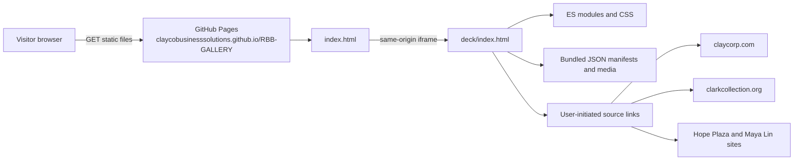

<!-- Auto-generated by the documentation-automation workflow on 2026-10-19. -->

# Architecture

## Overview

RBB-GALLERY is a public, static exhibition presentation. The root page loads the deck in a same-origin iframe; the deck and its locally bundled assets are served as static files. There is no application server or backend API in this repository. The README identifies the public review URL as <https://claycobusinesssolutions.github.io/RBB-GALLERY/> and says the reviewed presentation is served from `main` ([README.md:3-5](../README.md#L3-L5)).

## Components and flow

- **Public shell:** `index.html` applies a restrictive Content Security Policy and embeds the deck; `public.js` mounts the iframe, synchronizes slide hashes, and safely retires an older service-worker route ([index.html:2](../index.html#L2), [public.js:16-60](../public.js#L16-L60)).
- **Presentation:** `deck/index.html` defines the scenes and loads styles, bundled GSAP, and ES modules. `deck/src/presentation.js` coordinates scene navigation and feature modules ([deck/index.html:1-4](../deck/index.html#L1-L4), [deck/index.html:134-135](../deck/index.html#L134-L135), [deck/src/presentation.js:1-13](../deck/src/presentation.js#L1-L13)).
- **Feature modules:** artwork and project fields, project details, menu/preview, Hope Plaza gallery, optional spatial studies, and mobile behavior are implemented in `deck/src/`. The HTML identifies the invitation, project, art/collaboration, and possibility chapters ([deck/src/museum-menu.js:6-23](../deck/src/museum-menu.js#L6-L23)).
- **Static content:** JSON catalogues and images reside under `deck/assets/`; project details and artwork metadata are fetched from same-origin JSON files ([deck/src/seminal-projects.js:14-17](../deck/src/seminal-projects.js#L14-L17), [deck/src/presentation.js:116-125](../deck/src/presentation.js#L116-L125)).
- **Local preview:** `launch.py` runs a loopback-only Python HTTP server and supports byte ranges ([launch.py:1-4](../launch.py#L1-L4), [launch.py:56-71](../launch.py#L56-L71)).

## Technology and design

The application uses plain HTML, CSS, and native JavaScript ES modules, with vendored GSAP and Three.js; no package manifest or build pipeline is present. Relative asset paths keep the presentation deployable as a static subpath. The outer page and deck coordinate through validated same-origin `postMessage` events. The service worker has no fetch handler, cache, encryption, or persistent storage ([sw.js:2-21](../sw.js#L2-L21)).

The application stores only the current scene in browser `sessionStorage` to restore a visit, and keeps the corresponding scene identifier in the URL hash ([deck/src/presentation.js:192-212](../deck/src/presentation.js#L192-L212)).

## Configuration

No GitHub Actions workflows or workflow variable references are present in the repository, and the issue supplied no resolved configuration rows. Deployment-specific hostnames, environment tiers, and settings beyond the README's public review URL are therefore not established here.
