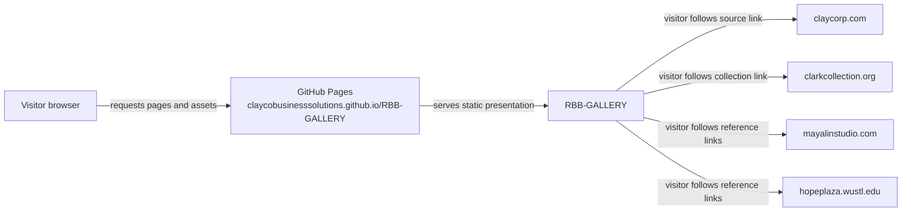

<!-- Auto-generated by the documentation-automation workflow on 2026-10-19. -->

# Integrations

This is a static presentation with no backend integrations or external API calls. Its runtime data and media are served from the same origin. The entries below distinguish that hosting dependency from links that only open when selected by a visitor.

| Dependency | Type | Direction | Auth method | Credential location | Environments |
|---|---|---|---|---|---|
| GitHub Pages at `claycobusinesssolutions.github.io/RBB-GALLERY` | Static hosting | Inbound browser requests | Public; none | None | Public review |
| `claycorp.com` | Project source website | Outbound, visitor-initiated links | None in this app | None | Public presentation |
| `clarkcollection.org` | Collection reference website | Outbound, visitor-initiated link | None in this app | None | Public presentation |
| `mayalinstudio.com` | Hope Plaza reference website | Outbound, visitor-initiated link | None in this app | None | Public presentation |
| `hopeplaza.wustl.edu` | Hope Plaza reference website | Outbound, visitor-initiated links | None in this app | None | Public presentation |

## Static hosting

The README identifies the public review URL and says the presentation is served from `main` ([README.md:3-5](../README.md#L3-L5)). The exact hosting configuration and its network controls are not checked in. The runtime shell embeds `deck/index.html`; local JSON manifests and assets are served from the same origin ([index.html:2](../index.html#L2), [deck/src/seminal-projects.js:14-17](../deck/src/seminal-projects.js#L14-L17)).

## Project references — `claycorp.com`

The project catalogues store public project URLs and the project detail dialog presents a “View project on Clayco” link. Following a project link opens the cited source site; the app does not fetch the site as an API. If the site is unavailable, its external project pages cannot be opened, but the locally bundled presentation remains available ([deck/assets/projects/cover-manifest.json:3-19](../deck/assets/projects/cover-manifest.json#L3-L19), [deck/src/seminal-projects.js:34-62](../deck/src/seminal-projects.js#L34-L62)).

## Collection and Hope Plaza references

The collection scene links to `clarkcollection.org`; the Hope Plaza scene links to Maya Lin Studio and Washington University Hope Plaza pages ([deck/index.html:26](../deck/index.html#L26), [deck/index.html:74](../deck/index.html#L74)). These are visitor-initiated links, not data integrations. Their credentials and network paths are not applicable to this app.

## Explicitly absent connections

No SQL or other database, storage account, message broker, SaaS API, Clayco internal API, identity provider, Key Vault, or federated identity credential is configured or called by this repository. No credentials or secret names are required by the checked-in application.
